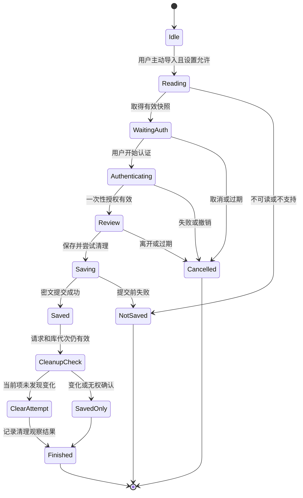

# ZeroInput 安全剪贴板后续开发方案

更新日期：2026-10-31。源码基线：`3cbfaa1`。状态：开发设计，尚未实现新的系统正文导入能力。

实施进度：已开始 P1，仅测试 APK 中存在固定公开样本取数原型；API 37 独立模拟器首轮验证与原有面板回归已通过，基线版本和来源矩阵尚未完成。详见 [P1 验证记录](clipboard-p1-validation.md)；生产导入功能和 P2/P3 仍未实现，持续进度仍以项目推进记录为准。

本轮选定的路线是：保留不经过系统剪贴板的直接私密复制；对只提供普通复制的应用，增加用户主动读取系统当前项、认证并加密保存、随后尽力清理当前项的入口。启用时说明系统暴露及清理限制，并引导用户调整其他应用的读取权限。

本文替代本文件之前以无障碍页面取字和 OCR 为中心的待定入口设计，作为本轮后续开发的详细计划。持续进度只记入 [项目推进记录](project-progress.md)，不另建状态文件。现有验证报告保留原始结论，不作为新能力已经通过验收的证据。

## 1 决策和交付范围

### 1.1 首版行为

| 编号 | 要求 | 交付判据 |
| --- | --- | --- |
| R01 | 保留当前编辑器选区、PROCESS_TEXT 和纯文本分享导入 | 原入口不增加系统正文读取，不因源菜单缺失而静默切换来源 |
| R02 | 新增独立的系统剪贴板主动导入授权 | 首次启用、已有用户升级、取消和页面重建均不会隐式开启 |
| R03 | 提供权限设置引导及限制说明 | 不声称自动修改了其他应用权限，也不把返回设置视为修改成功 |
| R04 | 键盘和应用内均有明确导入入口 | 正文只在有效的主动导入请求中读取，不依赖变化回调先到达 |
| R05 | 只处理有界纯文本快照 | 不访问 URI、图片、文件、历史记录或来源包，不静默截断 |
| R06 | 认证后预览并显式保存 | 认证回调、普通键盘展开、页面启动和通知到达均不自动保存 |
| R07 | 确认保存后尝试清理原当前项 | 保存失败不清理，已发现当前项变化不清理，结果分别报告 |
| R08 | 保持离线、禁止 AI 和正文日志 | 新路径没有网络、模型、遥测、明文磁盘缓存和正文通知 |
| R09 | 协调原有自动清理 | 等待导入期间不会被 ZeroInput 自己的另一条清理流程抢先删除 |
| R10 | 生命周期和删除代次可撤销 | 过期、替换、取消、锁屏、库清空不会触发旧结果保存或后续清理 |
| R11 | 不影响日常输入 | 读取、加密和存储不进入按键热路径，无轮询及新增常驻服务 |
| R12 | 交付来源和版本明确的验证证据 | 区分模拟器、目标真机、源应用以及无法消除的系统竞态 |

这是本项目在当前约束下选定的开发路线，不宣称是 Android 唯一存在的数据交接方式。

### 1.2 安全承诺

直接私密复制承诺该入口不主动经过系统剪贴板。新增系统导入承诺用户主动操作、加密保存和尽力缩短当前项停留时间；内容在源应用普通复制时已经进入系统。

新路径不能保证 ZeroInput 第一个读取、独占读取、零系统副本、删除其他组件历史，或清理过程中绝不误删并发写入的新项。关闭第三方读取权限不会使系统剪贴板服务本身看不到正文，也不会追回此前的复制、收藏或云端副本。

### 1.3 首版排除项

- 不增加 root、无障碍、Shizuku、运行时 ADB/Shell 授权、系统签名、Hook、反射或私有接口绕过。
- 不加入截图、MediaProjection、OCR、默认助手或默认笔记角色依赖。
- 不做“点击来源应用普通复制后必然全自动入库”的承诺；该扩展单列在第 12 节。
- 不为修改权限读取完整应用清单，不申请 QUERY_ALL_PACKAGES、使用情况权限或新的高权限服务。
- 不清理其他应用数据，不承诺删除厂商历史、固定条目、收藏和同步副本。
- 不更改安全库持久化格式、密钥、容量和已批准的两阶段私密粘贴机制。

## 2 当前实现和平台依据

### 2.1 可复用的实现

| 当前组件 | 已有职责 | 后续处理 |
| --- | --- | --- |
| [ClipboardSelectionReader](../app/src/main/kotlin/dev/zeroinput/ime/clipboard/ClipboardSelectionReader.kt) | 有效编辑器的有限选区读取，后台执行及失效检查 | 保留直接路径，禁止在失败时改读系统剪贴板 |
| [ClipboardSelectionTransfer](../app/src/main/kotlin/dev/zeroinput/ime/clipboard/ClipboardSelectionTransfer.kt) | 单份内存草稿和一次性令牌交接，5 秒过期 | 可复用交接模式；系统导入的清理凭据不能借给直接复制 |
| [ClipboardImportActivity](../app/src/main/kotlin/dev/zeroinput/ime/clipboard/ClipboardImportActivity.kt) | 认证、预览、显式保存及草稿生命周期 | 提取必要的保存结果回调，避免复制整套认证流程 |
| [ClipboardImportText](../app/src/main/kotlin/dev/zeroinput/ime/clipboard/ClipboardImportText.kt) | 长度、空白、NUL、代理对校验；去除 spans | 复用字符校验，保留正文空格和换行 |
| [AndroidSystemClipboard](../app/src/main/kotlin/dev/zeroinput/ime/clipboardguard/AndroidSystemClipboard.kt) | 元信息、监听、清理；不读正文 | 保持原防护路径无正文能力，复用受控清理操作 |
| [ClipboardGuardRuntime](../app/src/main/kotlin/dev/zeroinput/ime/clipboardguard/ClipboardGuardRuntime.kt) | 防护生命周期、后台队列和提醒 | 与新流程统一协调本应用的清理请求 |
| [SecureClipboardVault](../user-data/src/main/kotlin/dev/zeroinput/userdata/SecureClipboardVault.kt) | 一次性授权、串行写入、删除代次和加密库 | 保持现有存储契约，不跳过授权检查 |
| [AuthenticationBroker](../app/src/main/kotlin/dev/zeroinput/ime/auth/AuthenticationBroker.kt) | 可取消的一次性系统认证 | 复用；当前请求超时为 30 秒 |

当前 `minSdk=26`，`compileSdk=36`，`targetSdk=36`。正文上限为 8192 UTF-16 单元，标签上限为 64，库容量为 100 条。当前新增操作会解密、读取已有库并重写，因此“只新增一条”不等于不读取已有私有正文。

现有导入页正文在认证后显示；认证回调不直接保存。现有草稿超时 120 秒、认证后确认超时 30 秒；新系统导入的更短草稿期限在第 4 节单独定义，不改变其他入口的既有期限。

### 2.2 平台能力分类

| 分类 | 结论及前提 |
| --- | --- |
| 官方支持 | 获准的应用可读取系统当前 `ClipData`；Android 10+ 的默认输入法或有焦点应用具有常见读取资格，仍受其他访问检查约束 |
| 官方支持 | Android 9+ 可调用 `clearPrimaryClip()`；API 26–27 可用字面量空文本覆盖当前项 |
| 官方支持 | 可以打开应用详情或应用管理等设置页面；设置页面不返回“其他应用权限已全部关闭”的证明 |
| 需要原型 | 当前 ROM 的可达设置入口、焦点切换、读取拒绝表现、清理后的可观察状态和耗时 |
| 依赖厂商 | 逐应用剪贴板权限开关、是否可禁止前台读取、系统组件例外及历史或同步设置 |
| 当前不可实现 | 普通 IME 自动修改其他应用 AppOps、接管所有复制菜单、取得读取优先权、原子读取并清理指定版本 |

访问资格依据 [Android 10 隐私变化](https://developer.android.com/about/versions/10/privacy/changes#clipboard-data)；读取和清理接口见 [ClipboardManager](https://developer.android.com/reference/android/content/ClipboardManager)。权限修改所需能力见 [AOSP Android 16 AppOpsManager](https://android.googlesource.com/platform/frameworks/base/+/refs/tags/android-16.0.0_r1/core/java/android/app/AppOpsManager.java) 和 [系统权限定义](https://android.googlesource.com/platform/frameworks/base/+/refs/tags/android-16.0.0_r1/core/res/AndroidManifest.xml)。这些平台依据不等于 OriginOS 真机验收。

### 2.3 场景覆盖

| 来源 | 首选路径 | 新系统导入路径的覆盖范围 |
| --- | --- | --- |
| 当前正在编辑的输入框选区 | 原有 InputConnection 直接复制 | 只在用户另行选择系统导入时读取当前项 |
| 聊天气泡、帖子、评论、社群消息 | 源应用提供的文本交接 | 能普通复制出文本即可导入，可能是整条消息 |
| 浏览器和应用内网页 | 选区交接或文本分享 | 取决于普通复制结果；网页原始结构不随之获得 |
| PDF | 阅读器自己的文字复制或交接 | 能写出纯文本时可用；不能复制文字的扫描页不覆盖 |
| 自绘文字、图片文字 | 源应用主动提供文字结果 | 没有文本输出就不覆盖，不自动启动 OCR |

自定义菜单只影响入口；缺少标准选区交接影响直接导入；是否暴露无障碍节点不参与本路线；自绘页面能否普通复制取决于源应用。四种情况分别记录，不能统一标为“无法读取”。

## 3 用户流程和设置

### 3.1 功能名称和授权

安全剪贴板、隐身模式、系统剪贴板防护是不同设置。新增独立选项“允许从系统剪贴板导入”，默认关闭。安全库已开启的老用户升级后也不能默认获准读取系统正文。

现有隐身模式的启用说明及对应测试需要同步区分直接复制和系统导入，不能在引导用户走新路径的同时要求完全不使用系统复制。隐身开关仍不自动开启监听或系统正文读取，也不改变禁止学习和 AI 访问的边界。

首次启用安全库时介绍两条路径，并让用户明确选择是否启用系统导入。仅使用直接私密复制的用户可以保持该选项关闭。已有用户在第一次主动选择系统导入时完成同样的说明。关闭安全库或系统导入会撤销未完成请求；关闭开关不删除已保存密文。

建议启用说明文案：

> 启用后，你可以主动把系统剪贴板中的文字保存到安全剪贴板。普通复制会先把文字交给 Android 系统。保存成功后，ZeroInput 会尝试清理当前项，但不能撤回其他应用、系统历史或同步服务已经保存的副本。清理与其他应用写入同时发生时，也可能影响刚复制的新内容。

提供“前往权限设置”“启用系统导入”“取消”三个明确动作。前往设置不等于启用，返回后仍保留未确认状态。新增用户文案同步维护中文和英文资源，正式界面不展示 API 名称或内部状态枚举。

### 3.2 权限设置引导

1. 说明建议在系统允许时限制不需要读取剪贴板的应用，并单独检查历史及同步设置。
2. 优先采用已验证、公开支持的厂商设置入口；没有时尝试 Android 公开的应用管理或指定应用详情入口，再退到系统设置。
3. 指定应用详情只针对用户选择的对象；不扫描全量应用，不猜测未公开 Activity 或调用私有接口。
4. 若无可用页面，给出该设备适用的手工路径，允许返回继续使用导入。不得显示“已自动保护”。
5. 只记录本功能是否已获用户同意；“已访问设置”或用户自述“已检查”均不能升级为权限验证结果。

系统设置才有权限修改其他应用的访问策略。Android 10+ 本身已有普通后台读取限制；电池后台限制、后台联网限制不是剪贴板读取权限的替代品。禁止读取也可能影响目标应用正常粘贴。

公开导航接口见 [Settings 应用详情](https://developer.android.com/reference/android/provider/Settings#ACTION_APPLICATION_DETAILS_SETTINGS)。未来发现厂商公开接口时，应先验证授权范围和结果语义，再增加有界适配；首版没有“自动限制其他应用”的实现分支。

### 3.3 来源应用普通复制后主动导入

初始状态为用户在来源应用看到目标文字，安全库和系统导入已经启用。

1. 用户长按、调整范围并点击来源应用“复制”。系统已经持有正文。
2. 用户点击键盘中的“导入系统剪贴板”，或打开 ZeroInput 后点击同名按钮。
3. 按钮创建一次性请求。后台读取当前快照，进入受保护的认证页面；读取失败时不尝试清理。
4. 用户点击认证，完成系统生物识别或设备凭据认证。此前不展示正文。
5. 显示冻结的正文及可选标签。用户检查后点击“保存并尝试清理”。
6. 后台保存成功，再复核原当前项及请求有效性，最多进行一次清理；分别显示保存结果与清理状态。
7. 用户关闭结果页或返回来源应用。下一次粘贴继续使用原有认证和返回后确认流程，不自动插入正文。

键盘入口需要 ZeroInput 正在提供该键盘；打开有焦点的 ZeroInput 页面导入不要求先聚焦外部输入框或切换默认输入法。启动页面可能使原页面失焦、选区消失、IME 连接改变。已取得的快照由导入请求独立持有，不继续依赖原输入连接。

新键盘入口沿用当前 `privacy.isSensitive` 的限制，无有效会话、密码、PIN、未知敏感类型及临时系统凭据编辑器中不提供导入动作。独立前台入口使用自己的主动请求，不从外部敏感编辑器读取任何内容。不得为了新入口放宽现有敏感输入、学习或私密粘贴策略。

若用户在导入前又复制了其他文字，实际取得的是读取时的当前项。预览必须明确展示这份快照，不能以先前提醒的时间推断正文仍是原内容。

### 3.4 操作次数和便捷入口

以下是首版验收口径，系统凭据输入的实际点击次数另外记录。

| 情况 | 入库动作 | 额外操作 |
| --- | --- | --- |
| 导入按钮已经可见 | 点击导入、点击认证、完成认证、确认保存，共 4 个交互阶段 | 来源应用的长按、选区调整和复制另计 |
| 键盘未显示 | 上述流程 | 可能还需聚焦输入框、打开面板；应用内入口可避免聚焦外部输入框 |
| 手动打开 ZeroInput | 应用内点击导入后走上述流程 | 启动应用、到达按钮的次数由布局实测 |
| 原有直接复制 | 点击直接复制、认证、预览并保存 | 不新增系统复制、权限设置和系统清理步骤 |

首版先复用现有认证与确认流程。原型证明安全和可用后，可以将“点击导入”和“启动认证”合并，但认证成功后仍需确认保存，不能为减少点击复用旧授权。

桌面快捷入口、快捷设置磁贴、通知或悬浮提醒只属于后续便捷入口。首版不新增特殊权限；如果复用已有提醒，点击只进入受保护页面，不能凭陈旧提醒直接读取、保存或清理。外部 Intent 打开页面也不自动构成读取授权。

### 3.5 预览及范围调整

首个取数原型按完整快照保存，以便逐字符核对。完整产品阶段可增加应用内的纯文本范围截取，选择操作只作用于已取得的快照，不能据此宣称系统只授权了该范围。

范围截取不能启用系统“复制／剪切”菜单重新写入系统剪贴板；不引入 WebView、AI 或外部文本处理菜单。保留原始 UTF-16 字符，不自动 trim、合并换行、纠正数字或规范化 Unicode。范围边界不得切断代理对；复杂 emoji 的用户可见字符边界在 UI 原型中验证。

如果只保存片段而尝试清理整份系统当前项，保存按钮附近应说明“清理针对系统当前整项”。清理凭据仍关联最初读取的当前项，不改为关联用户截取后的正文。

### 3.6 保留直接私密复制

当前编辑器选区先通过有效 InputConnection 读取，再将快照交给认证页面。读取前后的编辑器、选区、会话和交互检查保持不变；开始读取前已失效的选区不能靠打开页面恢复。

PROCESS_TEXT 和纯文本分享仍只接收来源应用主动交接的文本。新系统导入开关关闭或平台拒绝读取时，这些入口仍可用。直接路径不自动读取系统当前项，也不能把其保存结果当作任意系统项的清理凭据。

## 4 请求状态和生命周期



图中未展开的异常按下表处理。状态机属于设计契约，不代表新增类已经存在。

| 事件 | 保存前 | 已跨过保存提交点 |
| --- | --- | --- |
| 取消、锁屏、非认证页面切换、页面重建 | 撤销请求及授权、丢弃草稿、不清理 | 保留已提交密文，停止后续清理，不伪报未保存 |
| 系统认证临时遮挡页面 | 只允许当前认证请求继续，禁用其他操作 | 不适用 |
| 设置收紧或默认输入法变化 | 撤销旧请求；从独立前台入口重试可重新取得资格 | 不继续使用旧清理资格 |
| IME 因已发起的导入导航而解绑 | 页面取得一次性交接后可继续；不保留旧 InputConnection | 页面以新的前台资格检查清理 |
| IME 在交接前意外销毁 | 丢弃未交接结果 | 不从服务重建恢复清理 |
| 观察到系统当前项变化 | 保留冻结快照供用户确认，但使原清理凭据失效 | 保存原快照，跳过旧清理 |
| 安全库清空或删除代次变化 | 排队新增失效，不能复活已清数据 | 清空按仓库串行规则生效；旧流程不再清理系统项 |
| 重复点击或延迟认证回调 | 同一请求最多一次保存；替换请求不继承旧授权 | 不重复入库、不重复清理 |
| 进程死亡 | 不恢复草稿、授权或操作 | 密文可能已提交；重启后不推断结果、不恢复清理任务 |

生命周期预算：交接令牌沿用 5 秒；新系统导入的未认证草稿最多 30 秒；认证请求沿用当前 Broker 的 30 秒；认证后预览及保存确认最多 30 秒，并服从授权本身更早的期限。使用单调时钟计算本应用期限，平台剪贴板时间戳只作为观察值。

平台 Binder 调用和已经开始的存储提交不保证可被线程中断。取消必须使结果失效并阻止后续动作，不能通过不断新建线程假装取消成功。存储越过提交点后的实际结果由仓库契约决定。

## 5 数据读取和内存边界

### 5.1 一次主动请求允许的操作

1. 校验功能同意、请求代次、设备解锁状态，以及读取时的默认输入法或前台焦点资格。
2. 从当前请求取得一次正文读取许可；点击之外的生命周期回调不能产生这种许可。
3. 最多执行一次 `getPrimaryClip()`。取回的对象可能包含整份 ClipData；系统不提供按目标字符范围读取的授权。
4. 验证单项目、存在纯文本、无 URI／Intent、长度和字符合法性。拒绝多项目、空白、NUL、无效代理对和超过 8192 UTF-16 单元的文本。
5. 若同项同时带有 HTML 和纯文本，只提取 `item.text` 的字符并丢弃格式；不解析 HTML，不调用可能打开 URI 的 `coerceToText()`。原外部 Intent 导入的严格规则保持独立。
6. 将字符复制到应用所有的有界缓冲区并释放平台对象引用，建立与原项关联的清理观察信息。

原项时间戳等观察信息应从同一次返回的 ClipData 描述中取得。不能先读到 A 的元信息、再取得 B 的正文，却把两者拼成同一个快照；缺少可用观察信息时允许保存正文，但不建立可执行的清理凭据。

8192 上限约束应用接纳的正文，不能限制系统在返回整个 ClipData 前产生的 Binder／反序列化开销。超大或异常对象必须安全失败，但不得宣称已实现系统级按长度授权。

### 5.2 正文生命周期

正文只存在于本次草稿、认证后预览和已有仓库存储操作所需的短期内存。Intent、Bundle、SavedState、日志、异常消息、通知、剪贴板标签及长期缓存均不得携带正文。

新草稿来源必须由内部代码标记为 `SYSTEM_CLIPBOARD`，且 `allowsAiImport=false`；外部调用者不能通过 extra 改成内部来源或授予系统读取能力。现有外部分享的独立 AI 入口不因此获得系统快照。

关闭时清零自有字符／字节缓冲区并释放 View、String、ClipData 引用。Android IPC、不可变 String 和系统服务中的副本不能保证被应用安全擦除。唯一计划新增的磁盘副本是安全库正常写入的密文；不增加明文缓存或独立加密待处理队列。

## 6 保存和清理协议

### 6.1 保存优先

正常顺序为“读取快照 → 认证及确认 → 加密提交 → 复核 → 尝试清理”。保存前不得清理，也不得先把正文写到临时文件以追求更短的系统停留时间。

这意味着认证和用户预览期间正文可能仍在系统当前项中。若改为先清理，会带来认证取消、磁盘故障或库满后无法恢复内容的问题；首版不采用这种顺序。

保存继续使用现有授权、加密、串行锁、删除代次和回滚行为。不得为自动入库跳过 `AuthenticationGrant.consume()`，也不能把启用开关当作长期解密授权。

### 6.2 清理前的检查

清理协调器必须同时满足：

- 本次保存确实成功；请求未取消，相关设置及库删除代次仍有效。
- 用户确认过“保存并尝试清理”，且当前设备解锁、访问资格有效。
- 待清理观察信息来自这次正文快照，不来自任意陈旧通知。
- 读取后没有已知的替换事件，最终元信息没有发现变化，且没有其他 ZeroInput 清理请求拥有该操作。
- 平台元信息不可取得、无法判断或访问被拒绝时，跳过清理；不能把未知解释为“仍是原项”。

时间戳不是唯一身份；同文本和同时间戳也不构成原子版本证明。同一内容可能收到多次分类回调；无法区分时宁可撤销清理资格，不能重复读取正文来追踪变化。

### 6.3 无法消除的竞态

以下序列即使所有本应用检查通过，仍可能发生：

```text
读取 A → 保存 A → 最后检查仍为 A → 其他应用写入 B → 清理实际删除 B
```

Android 公开接口没有 compare-and-clear。应用内部锁只能串行化 ZeroInput 的请求，不能锁住其他应用。关闭其他应用读取权限也不等于禁止它们写入。此项是已知平台限制，测试不能证明它绝不会发生。

AOSP 的读取与清理是分开的请求，清理没有指定旧版本参数，也不返回成功凭据，见 [Android 16 ClipboardService](https://android.googlesource.com/platform/frameworks/base/+/refs/tags/android-16.0.0_r1/services/core/java/com/android/server/clipboard/ClipboardService.java)。

### 6.4 操作和结果

API 28+ 调用一次 `clearPrimaryClip()`；API 26–27 只写入 `ClipData.newPlainText("", "")`。不随机覆盖，不写入密文或提示文字，不反复清理直到为空，不在清理失败时恢复正文到系统。

| 内部结果建议 | 用户反馈含义 | 后续动作 |
| --- | --- | --- |
| `NOT_SAVED` | 未保存，未尝试清理 | 结束或由用户重新发起 |
| `SAVED_SKIP_CHANGED` | 已保存；系统剪贴板已变化，未清理 | 不删除新项 |
| `SAVED_SKIP_UNAVAILABLE` | 已保存；无法确认当前项，未清理 | 不自动重试 |
| `SAVED_CLEAR_ATTEMPTED` | 已保存，已尝试清理系统当前项 | 可记录瞬时元信息观察，不能宣称历史已删除 |
| `SAVED_CLEAR_FAILED` | 已保存；清理失败或当前项仍可能保留 | 若再清理，必须是新的独立用户操作 |
| `OUTCOME_UNAVAILABLE` | 无法确认上次操作结果 | 不自动再保存或清理，可由用户认证查看安全库 |

null、空状态或未抛异常不能单独证明权限未被拒绝，更不能证明独立历史已删除。当前 guard 的 `CLEARED` 状态不应直接映射为新流程的强成功结果。

跨进程崩溃的“恰好一次保存并清理”不在首版保证内。已经保存的条目不会因清理失败回滚；取消也不隐式删除已提交密文。

## 7 原有防护和权限持续时间

### 7.1 自动清理协调

“无条件自动清理系统当前项”和“等待主动导入后清理”互斥。仅在开始导入后暂停旧清理不足以解决问题，因为内容可能早已被旧模式清掉。

启用系统导入时，如果旧自动清理已开启，确认页明确说明将切换为“主动导入后清理”；用户确认后一次性提交设置并撤销旧清理队列，取消则全部保持原值。关闭系统导入不自动恢复旧的破坏性模式。重新启用旧自动清理也应明确关闭冲突模式并取消未完成导入。

单纯的元信息提醒可以保留。其回调不能读取正文、产生保存授权或抢先清理。对于用户另行发起的“仅清理当前项”，在有导入请求时应先结束该请求并重新确认，不能两个流程同时操作。

这项协调必须覆盖启动自动清理、恢复防护、设置页获得焦点、直接复制后的旧清理触发点以及已排队任务，不能只修改新按钮。

### 7.2 能力与期限

| 能力 | 首版需要与否 | 范围和期限 |
| --- | --- | --- |
| 默认输入法身份 | 键盘入口需要；应用前台入口不需要 | 身份持续到用户切换；不是独占读取授权 |
| 前台窗口焦点 | 应用入口读取、确认保存及清理检查需要 | 每次请求重新检查，失焦撤销对应操作资格 |
| 用户系统导入同意 | 需要，独立于库开关 | 持久化选项；只允许之后主动发起请求，不授权持续采集 |
| 系统认证 | 每次保存需要 | 一次性、短时；不复用，不持久化 |
| 剪贴板变化监听 | 手动导入不需要 | 用户另行开启提醒时按原默认 IME／服务生命周期运行 |
| 通知权限、悬浮窗权限 | 首版主流程不需要新增申请 | 现有可选提醒独立授权，拒绝不影响主动导入 |
| 网络、存储、截图、无障碍或 Shell 能力 | 本功能不使用 | 其他功能已有权限不能扩大本功能数据访问 |

新前台主动导入不应要求用户先开启全局监听。旧 guard 的监听开关和身份检查仍按原契约生效，不得为了新功能把所有旧操作的访问检查删掉。

## 8 架构和安全规则调整

### 8.1 建议职责划分

以下新名称是设计建议，并非现有文件。

| 所属位置 | 职责 | 明确不承担 |
| --- | --- | --- |
| `ime-ui` | 两种复制入口、忙碌状态、通用结果展示 | 系统读取、认证、存储 |
| `app/clipboard/SystemClipboardImportCoordinator` | 主动请求、快照所有权、生命周期、保存和清理结果衔接 | 网络、输入引擎、全局监听 |
| `app/clipboard/SystemClipboardImportAdapter` | 唯一新增正文读取适配器；解析当前 ClipData 为受限纯文本 | 监听、自动保存、来源追踪、内容 URI 访问 |
| `app/clipboard` 的非导出导入页面 | 认证后预览、范围调整、保存确认 | 接受外部系统读取指令、回传私有库内容 |
| `app/clipboardguard` | 原无正文防护、统一清理互斥及元信息操作 | 为变化事件读取或入库正文 |
| `user-data` | 已有加密库与提交契约 | Android 剪贴板 API、Activity、IME |
| `security` | 已有加密原语和一次性授权 | 新的业务来源规则 |
| `ZeroInputService` 和 AppGraph | 组合、入口和生命周期接线 | 堆入完整导入状态机 |

现有元信息端口保持无正文方法。新正文端口只注入主动导入协调器，不能注入 guard、AI、引擎或通知组件。新增协调不要求新 Gradle 模块或通用工作流框架。

读取和存储采用有界后台执行；正文请求最多一份，重复请求取消旧草稿而非排队收集。所有权交接只传随机的一次性内存令牌。新页面默认不导出，不能扩展已有 ACTION_SEND／PROCESS_TEXT 接收器来接受“读取系统当前项”指令。

### 8.2 需同步的边界文件

| 文件 | 实现时的具体调整 |
| --- | --- |
| [AGENTS.md](../AGENTS.md) 第 3.2、7 节 | 将“所有正文读取禁止”改为精确限定的主动导入例外；其余自动采集和跨应用权限限制保持 |
| 新 ADR | 记录双路径、系统暴露、逐次认证、非原子清理和旧模式协调；使用实施时下一可用编号 |
| [ADR 0002](adr/0002-private-clipboard.md)、[ADR 0006](adr/0006-private-text-import.md)、[ADR 0007](adr/0007-system-clipboard-guard.md)、[ADR 0012](adr/0012-keyboard-private-copy-and-foreground-cleanup.md) | 增加新决策关联，保留历史适用范围，不改写既往验证事实 |
| [architecture.md](architecture.md) | 新适配器、状态所有权、依赖方向和清理协调 |
| [threat-model.md](threat-model.md)、[SECURITY.md](../SECURITY.md) | 新正文入口、事件误识别、权限拒绝、崩溃及清理竞态威胁 |
| [build.gradle.kts](../build.gradle.kts) | 精确的正文读取文件例外及其负向自测；不能删除全局检测后放任所有组件访问 |
| [README.md](../README.md) | 首次设置、两种复制、清理含义及实际支持版本 |
| Manifest 和中英文资源 | 非导出页面、安全窗口、文案及合并清单验证；核心流程不新增权限 |

当前 `testPrivacyBoundary` 明确要求所有正文读取都被拒绝。实施新例外必须同时更新规则与测试：只允许新的指定适配器及固定公开样本的平台测试；原 guard、AI、普通业务、复制路径或任意重命名文件中的读取仍失败。字符串扫描不能证明运行时授权，必须同时验证许可只能由有效用户动作产生。

这是用户新策略引起的有限安全模型调整，不是为了通过检查放宽白名单。本轮文档交付不修改上述生产规则，也不把新路径写成已经实现。

### 8.3 威胁和控制

| 威胁 | 控制和剩余边界 |
| --- | --- |
| 应用自行写入被误当作用户复制 | 首版只在明确导入动作读取；监听事件不能授权正文 |
| 外部组件伪造导入请求 | 非导出页面、内部一次性令牌；外部 Intent 只能导航或交接其自带文本 |
| 系统内容被替换 | 冻结一次快照，预览确认；失效原清理资格，不替用户保存新内容 |
| 旧认证回调或重建页面复用授权 | 请求 ID、一次性消费、代次和超时校验；不保存状态恢复正文 |
| 未保存内容被清理 | 保存提交成功是清理前提；失败路径不清理 |
| 已保存内容被用户清空后又复活 | 复用删除代次，清空撤销请求及后续清理 |
| 其他应用读取、厂商保存、历史同步 | 权限引导和短时停留只能降低风险，不能证明没有副本 |
| 清理误删并发新项 | 最终复核和本应用串行化降低风险；系统缺少原子接口的窗口仍存在 |
| 预览被截屏、录屏或系统保存 | FLAG_SECURE、排除最近任务、禁用状态保存／Autofill／ContentCapture；不承诺对受控 OS 隐藏 |
| 预览编辑触发其他输入法读取 | 首版正文只读；范围调整不依赖普通文本输入框，标签沿用既有敏感输入策略 |
| 不可信正文或大量请求耗尽资源 | 固定长度、单请求、受限队列、失败关闭；平台返回前的开销不受应用完全控制 |
| 系统导入进入 AI 或日志 | 请求模型拒绝 AI，独立端口依赖和负向测试，错误只输出固定状态 |

## 9 原型和验收方法

### 9.1 先验证取数

第一轮使用独立测试源页面和固定公开样本，覆盖标准输入框、自定义复制菜单、可复制消息气泡和不提供文本的自绘页面。先证明读到的是预期系统文本，且未授权时完全不读正文，再接入真实安全库。

只在专用模拟器或隔离测试设备／用户资料中操作。若当前剪贴板可能含用户数据，不读取、导出、备份后恢复或覆盖它；换到干净测试环境。QQ、微信、LINE 和网页测试使用专门的公开构造内容，不读取真实聊天。

样本至少包含：前后空格、连续空格、TAB、LF／CRLF、中英文混排、NBSP、全角标点、网址、前导零数字、组合字符、ZWJ 家庭 emoji、肤色、旗帜、8192 边界及非法／超限输入。正确性比较以测试源实际写入的字符序列为准，同时单独记录源应用是否在复制时改变原文。

### 9.2 测试矩阵

| 编号 | 场景 | 必须观察到的结果 |
| --- | --- | --- |
| T01 | 全部关闭、仅启用库、仅打开键盘、普通 Activity 重建 | 正文读取次数均为零 |
| T02 | 启用说明取消、设置页返回、旧用户升级 | 未确认不开启，不生成“其他应用已受限”状态 |
| T03 | 默认 IME、非默认但有焦点、非默认且后台 | 前两者按平台许可工作；后台拒绝不尝试绕过 |
| T04 | OEM 拒绝本应用读取、null、SecurityException | 不把未知当空、不清理、不记录异常正文 |
| T05 | 有界 Unicode 样本及 HTML 同项纯文本 | 字符保持；格式丢弃；不解析 HTML 或访问网络 |
| T06 | URI、Intent、多项目、图片、无效字符、超限 | 拒绝导入，不打开 Provider，不清理 |
| T07 | 认证前、认证后、取消、授权超时及重复回调 | 认证前不展示，回调不保存，授权只消费一次 |
| T08 | 读取 A 后系统改为 B | 保存经用户确认的 A，检测到变化后不清理 B |
| T09 | 相同文本再次复制、时间戳冲突、重复分类回调 | 不宣称能可靠识别复制事件；不自动重复入库 |
| T10 | 最终检查和清理之间注入 B | 记录公开 API 的不可避免竞态，不把模拟成功当作原子保证 |
| T11 | 空间不足、库满、存储／Keystore 失败 | 无成功提交则不清理；仓库按既有回滚和阻断规则处理 |
| T12 | 已保存但清理拒绝、无返回值、仍有当前项 | 保存与清理结果分开，不自动重试或回写正文 |
| T13 | 在读取、认证、排队写入、提交后取消或锁屏 | 各阶段符合第 4 节；提交后不伪报未保存 |
| T14 | 导航导致 IME 解绑、切默认输入法、服务销毁 | 合法交接可继续；旧连接、旧资格不能用于之后请求 |
| T15 | 库清空与新增／清理并发 | 旧请求不恢复库，不继续清理系统项 |
| T16 | 进程在保存前、提交中、提交后终止 | 不恢复明文和清理任务；不保证跨进程恰好一次 |
| T17 | 原自动模式与系统导入相互切换 | 取消保持旧设置；确认后旧排队清理失效 |
| T18 | 通知、悬浮提醒、启动恢复和设置页自动检查 | 无正文读取；不能绕过新模式互斥 |
| T19 | 外部 Intent 伪造来源或过期令牌 | 不读取系统、不复用认证、不泄露私有库信息 |
| T20 | 预览截取、系统菜单、AI、Autofill 和状态保存 | 不生成新系统正文副本，不把快照交给 AI 或持久化 |
| T21 | 原直接复制、PROCESS_TEXT、分享、敏感输入及两阶段粘贴 | 原成功与负向用例仍成立；新键盘入口不绕过敏感会话检查，未增加静默系统读取 |
| T22 | API 26–27 与 API 28+ 清理 | 分别仅空文本覆盖和一次 clear；自生成事件不循环 |
| T23 | 设置入口缺失、OEM 更新、权限切换 | 可返回、状态准确；不调用猜测的私有入口 |
| T24 | 用户主动再次导入相同文本 | 每次独立授权；不靠长期正文指纹或后台扫描去重 |

平台基线至少覆盖 API 26 或 27、28、29、33、36。目标真机需重新记录机型、Android 版本、安全补丁、OriginOS 构建、默认输入法和源应用版本。历史 iQOO Neo9／Android 16 报告不能代替当前设备确认。

### 9.3 性能和体积

不引入 OCR 模型、新 native 库或后台保活。新增读取和保存应离开 IME 主线程，代码和资源增量单独计算，不能混入词库或其他功能更新。

| 指标 | 测量方法 | 初始验收预算 |
| --- | --- | --- |
| 输入延迟 | 同机同包配置 A/B，覆盖关闭、开启空闲、导入保存并发；每组至少 2000 次构造按键 | P95 增量不超过 1 ms；无可归因的丢键、错序或持续卡顿 |
| 原文取得耗时 | 单独记录点击到快照就绪的 P50／P95，排除用户认证等待 | P95 目标 100 ms；超出需定位平台调用或调度瓶颈 |
| 保存与清理耗时 | 库内 0、50、99 条，短文本和 8192 单元；分离排队、加密提交及清理 | 各阶段有界且不阻塞输入；实测后给出设备范围 |
| 内存 | 记录峰值 PSS、堆、草稿数、结束后回落；至少 100 次取消／成功循环 | 无随操作次数增长的保留；单份草稿，空闲不保留正文 |
| 包体 | 相同 ABI、构建模式、压缩和资源版本对比 APK | 新功能增量目标不超过 1 MiB，无模型或运行库增量 |

这些数值是开发预算，不是已测成绩。阶段 P1 记录设备和采样噪声后冻结测量口径，失败不能通过更换统计口径或删去慢样本变为通过。构造数据的耗时可以保留，生产正文、哈希、来源和操作轨迹不得变为遥测。

## 10 实施阶段和交付物

按以下顺序实施。先解决稳定取得正确内容，再接入产品和完整存储；不先重构整个输入法。

| 阶段 | 工作和交付物 | 完成条件 |
| --- | --- | --- |
| P0 设计基线 | 本文、当前源码映射、平台边界、进度关联 | 已形成可执行计划；新功能仍未实现 |
| P1 取数原型 | 为固定公开样本测试建立精确例外；验证前台／IME 读取、设置导航、字符与版本行为 | T01–T06 和权限入口证据成立；无真实数据、无高权限绕过 |
| P2 安全边界和状态机 | 新 ADR、规则精确调整、请求许可、代次、取消、保存结果模型、清理互斥及负向测试 | 原全局禁止变为明确有限例外；无未授权调用路径 |
| P3 产品闭环 | 启用说明、双入口、认证、预览／范围调整、现有库保存、尽力清理及中英文结果文案 | 构造内容完整导入和原有直接复制回归；T07–T24 成立 |
| P4 真机与资源验收 | 目标 ARM／OriginOS、实际源应用公开样本、性能和包体对比 | 给出具体支持组合、失败状态及测量数据，不以模拟器替代 |
| P5 文档和测试包交付 | 同步产品与安全文档、生成经过验证的 Debug 测试包和哈希 | 项目完成定义满足；发布、正式签名及推送不包含在自动动作中 |

P1 是隔离的能力验证，不把测试许可扩散到生产源码；P2 的边界文件与实现一起审阅。每阶段记录变更文件、测试命令、退出码、平台和未通过项目。若只完成 P1，不得将后续产品路径标为完成。

每次任务只修改所需模块并保留用户改动。默认单线推进；并行委派仍遵守仓库约定，不以本文自动授权多代理或多模型流程。

## 11 验证命令和完成定义

以下命令用于后续实现，均从仓库根目录执行。本轮仅文档编辑，不运行构建或设备测试。

```powershell
# 状态机、存储及已有模块回归和隐私边界自测
./gradlew.bat testDebugUnitTest testPrivacyBoundary privacyCheck :app:lintDebug --no-parallel

# 使用真实 Rime 的模拟器主包及测试包
./gradlew.bat :app:assembleDebug :app:assembleDebugAndroidTest `
  "-Pandroid.injected.build.abi=x86_64" -PrequireRime=true --no-parallel

# 仅在已选择的干净测试设备上运行；不得连着用户真实数据环境批量运行
./gradlew.bat :app:connectedDebugAndroidTest `
  "-Pandroid.injected.build.abi=x86_64" -PrequireRime=true --no-parallel

# ARM64 测试包；打包成功不等于真机功能已通过
./tools/package-test-apk.ps1 -Abi arm64-v8a

# 实现完成后的 Release 构建验证；不代表已正式签名或发布
./gradlew.bat :app:assembleRelease -PrequireRime=true --no-parallel
```

设备测试应明确目标设备；多个设备连接时不得直接使用上面的通用 connected 命令。新增用例可单独选择测试类执行，并保留旧剪贴板和安全存储回归。

完成时必须满足：

- R01–R12 均有对应实现和验收证据，所有启用、读取、认证、保存和清理状态可解释。
- 新系统读取只存在于指定适配器及固定公开样本测试；未授权动作的正文读取计数为零。
- 无新增高权限、联网、AI、正文日志、备份和明文磁盘路径；Debug／Release 合并清单符合边界。
- 直接私密复制、严格外部导入、敏感会话和原两阶段粘贴回归通过。
- 保存失败不清理；已发现变化不清理；保存与清理结果分离；剩余竞态没有被伪装成测试可消除的缺陷。
- 真实目标环境和性能证据完整，或明确列为尚未支持／未验证，不能标记全部完成。
- 安全库格式及数据保持；没有自动清空既有库或迁移密钥。
- 进度入口记录最终状态和下一步，文档与产物行为一致。

## 12 普通复制后的自动导入扩展

用户最初提出的“点击来源应用复制后自动读取、入库并清理”保留为单独扩展需求，不与首版主动导入混写。

系统变化回调不携带用户点击证明，也可能由分类变化重复触发；监听不保证在进程不存在时启动应用。因而持续处理所有变化会成为自动采集，而不是可靠识别用户的一次复制。[Android 监听接口说明](https://developer.android.com/reference/android/content/ClipboardManager.OnPrimaryClipChangedListener)

如果后续明确选择扩展，需要分别完成以下决策：

| 方案 | 实际收益 | 增加的代价和边界 |
| --- | --- | --- |
| 元信息提醒后点击导入 | 更容易发现入口，仍保留逐次主动授权 | 依赖默认 IME／服务存活及提醒设置，不能保证每次出现 |
| 用户先开启短时“接收下一次变化” | 限定时间和最多一份快照 | 变化不一定来自用户操作；仍需认证预览确认，且比直接按钮多一步 |
| 持续自动入库并清理 | 理想情况下减少手动操作 | 会处理应用自行写入，丢失回调仍可能发生；需要单独调整认证或存储，误清理和暴露窗口仍在 |

不能直接取消现有库授权检查来实现第三项。若研究独立加密暂存再认证入库，需单独评估新文件、密钥、容量、过期清理、崩溃恢复和迁移；该方案不属于首版，也不因本文自动批准。

## 13 历史证据和版本适用范围

- [剪贴板设备验证](clipboard-device-validation.md) 与 [模型集成验证](model-integration-validation.md) 保留原有普通应用修复和两阶段粘贴的测试事实；它们不证明新系统正文导入、当前 OriginOS 行为或厂商历史删除。
- [OCR 可行性实验](ocr-feasibility-2026-10-31.md) 的 API 37 x86_64 数据仅限当时样本和运行库。当前选择不引入 OCR，不把该实验解释为所有局部 OCR 都不可行。
- 历史问题涉及 iQOO Neo9／Android 16，但当前机型、系统构建、历史界面归属和应用版本需要在 P1／P4 重新记录。
- 旧计划中的厂商历史删除调查不再是本期交付目标；调查未建立可用公共删除接口的事实不能写成“已删除”或“所有厂商永远不支持”。

本文中的平台结论以已核对的 Android 公共文档及 AOSP `android-16.0.0_r1` 为依据；工程设计、交互预算和验收指标是后续实施契约。系统更新或厂商行为改变时，更新对应设备证据，不扩大已有验证结论。
