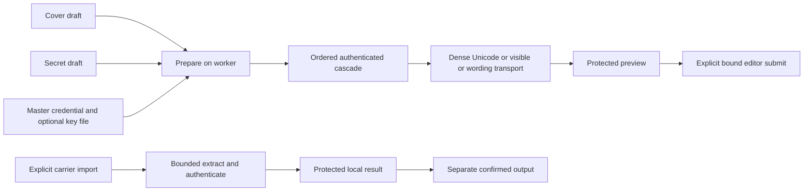

# Text steganography: design and feasibility review

Date: 2026-11-18. Revision: 2. Status: exact-text scope implemented and locally validated.
The frozen format and decisions are in [ADR 0039](adr/0039-text-steganography.md).
Results, the checked test package and remaining platform/channel limits are in
the [validation record](text-steganography-validation.md).
The user declined section 6.3's system-clipboard exception. Natural wording is
gated unavailable under sections 3.3/3.4; it is not an implemented enhanced profile.
Repository inspected at `3632434` with existing uncommitted audit changes retained.

The user requested design and evaluation before implementation. The user confirmed
that ZeroInput should use an independent format, drawing on Cipher Vault Toolbox's
security design rather than requiring interoperability. The user also confirmed
that page sources use explicit copy, selection or sharing before decryption.
The expanded request requires composable AES, XChaCha20, Kuznyechik, Twofish,
Camellia and SM4, selectable key strength, key files and stronger steganography.
The user confirmed one master credential deriving distinct per-layer subkeys.
The user also approved retaining exact-text mode and adding an optional local
visible-wording/expansion carrier, with preview and explicit submit confirmation.
In this document,
**cover text** means the visible public text, and **secret text** means the content
that is encrypted before being hidden. The cover text is not confidential.

## 1. Recommended scope

Add a manually opened keyboard panel resembling private temporary input. It owns
two isolated drafts, the cover and secret, plus an ordered algorithm list and master-credential
input. On explicit completion it prepares a preview and submits only the final
encoded text to the current editor. Decryption is a separate, local workflow.

Recommended v1:

- One to six ordered authenticated-encryption layers selected from all six
  requested algorithms. Each uses a domain-separated subkey from one message root,
  an independent nonce and a full authentication tag. Encryption follows the
  displayed order and decryption reverses it. Default to AES-256-GCM; offer
  AES-256-GCM followed by XChaCha20-Poly1305 as a convenient two-layer preset.
- Exact supported key sizes per algorithm, separate from three bounded Argon2id
  cost profiles. Do not sum key bits or label a cascade AES-512/AES-1536.
- Passphrase, random shared key, key file, or passphrase/random key plus a key file;
  one message KDF operation, never one Argon2 call for each layer.
- Dense Unicode and visible Base64url transports retained as compatibility modes.
  Evaluate an optional visible-wording transport for the anti-detection objective.
  Marker removal/selector dispersion alone does not satisfy that objective.
- Authenticate the visible cover and encrypted secret. Exact-text transports bind
  the exact cover. Wording transport binds its reversible canonical skeleton and
  resource, then verifies the complete regenerated surface before revealing text.
- Session-only credentials; no saved key store, automatic credential reuse, default
  vault save, network, AI processing, telemetry or clipboard monitoring.
- Explicit encrypted-text import from selection/share and an authenticated
  secure-vault item read. The proposed system-paste path was declined.
- Decrypted text stays on a protected local surface until a separate output action.
  Successful authentication never automatically inserts plaintext into an editor.

The cryptographic scope and optional local wording carrier are confirmed by the
user; the implemented wire format is frozen in ADR 0039. Wording still requires
the evidence gates below. Exact-text mode remains
available. Wording changes/expansion need an explicit profile choice, preview and
a subsequent explicit submit action; this is not permission to rewrite a message
automatically or generate an unreviewed long cover.

The keyboard mode begins off for each session and requires an explicit open action.
It is mutually exclusive with the private temporary-input panel. Reuse its editing
and invalidation patterns, not its default-open setting or automatic vault copy.
An eventual persistent default or saved-key feature needs its own consent design.

This is message encryption with a text wrapper. It does not provide undetectability,
sender identity, forward secrecy, replay prevention, or guaranteed transport through
filters. Anyone with the shared secret can produce a valid message. An attacker
can destroy the hidden content without learning it. Weak passphrases remain subject
to offline guessing. Compromised endpoints remain outside the protection boundary.

## 2. Findings from current code and the reference project

### 2.1 ZeroInput

| Component | Relevant existing behavior | Design implication |
| --- | --- | --- |
| `LocalDraftInput` | Bounded memory draft, separate conversion session, `NoPersonalization`, caret support and asynchronous engine preparation | Reuse conversion without committing intermediate secret input to the external editor |
| `PrivateDraftInput` | Masked display, worker ownership, request revision and explicit completion | Reuse lifecycle patterns; do not silently inherit its save-to-vault behavior |
| `ZeroInputService.privateDraftCommitTarget` | Checks the live connection, session, interaction and device state again at submission | Capture a fresh bound target for final encoded output; discard stale results |
| `ClipboardSelectionReader` | Explicit bounded editor-selection read, no clipboard fallback | Preserve this source boundary for decrypt imports |
| `ClipboardImportText` / `ClipboardImportIntent` | At most 8,192 UTF-16 units, valid surrogate pairs, no NUL, plain text only, no URI/provider resolution | New carrier limits can remain within the existing text limit; preserve actual code points |
| `SecureClipboardVault` and secure paste | Separate encrypted storage and one-use authenticated body reads, with deletion generations | Reading a stored carrier still requires device authentication before message decryption |
| `security/AesGcmEnvelope` | Internal storage format using JCE AES-GCM and separately owned Keystore keys | Share standard primitives where appropriate, not the storage format or vault keys |
| Root `privacyCheck` | Production system-clipboard body reads are prohibited; only the isolated P1 fixture has an exception | Foreground paste is a proposed policy change, not an already available capability |

See [ADR 0036](adr/0036-private-temporary-input.md),
[ADR 0037](adr/0037-isolated-draft-caret.md),
[ADR 0002](adr/0002-private-clipboard.md),
[architecture](architecture.md#private-text-collection), and
[the existing clipboard development plan](clipboard-product-repair-plan.md).
That plan's proposed system-import behavior is not a completed production capability.
It must not be assumed to authorize this feature's implementation automatically.

### 2.2 Cipher Vault Toolbox

Read-only reference root: `K:/workspace/vocabulary/cipher_vault_toolbox`.

There are two materially different implementations:

| Reference | Observed design | Suitability here |
| --- | --- | --- |
| `rust/src/text_steganography/` and its CVF1/CVF2 models | Resource-bound text rewriting/rank transport; XChaCha20-Poly1305, domain-separated keys and authenticated document context | Useful cryptographic separation patterns; poor default for short everyday messages |
| `lib/src/features/dense_text/` | Encrypt using the shared `CVTENC04` service, then encode bytes as variation selectors; also supports visible Base64url | Closest match to a cover-plus-secret keyboard workflow |

The high-capacity guide and implementation agree on the essential boundaries:
one byte maps to one of 256 variation selectors, exactly one framed block is
accepted, malformed characters fail, KDF profiles are checked before derivation,
and authentication failure releases no plaintext. It supports much larger input
than an IME should. Its ordered AEAD stages and protected key-material ownership
are useful references for the expanded cascade requirement.

The reference's high-capacity implementation does **not** authenticate its visible
cover. ZeroInput should make the stricter choice explicitly. Its older rewriting
passphrase provider uses public fixed domain inputs to derive a reusable profile
key; that is not a per-message random-salt design to copy into this independent
message format. The high-capacity shared encryption path does generate a random
salt. Do not conflate those two paths.

Its native `rust/src/aead.rs` currently accepts 256-bit keys for AES, Twofish,
Camellia and Kuznyechik/XChaCha20, with SM4 fixed to 128 bits. Its Dart stage UI
types must not be taken as proof of working 128/192-bit native profiles. The stage
keys in the reference are slices of expanded master material; ZeroInput instead
specifies explicit purpose/index/algorithm/key-size/transcript domains per layer.
`rust/src/generic_gcm.rs` implements its optional block-cipher GCM composition;
do not copy hand-written GCM into ZeroInput when a maintained implementation can
provide the construction. These are source findings, not independent audit claims.

Useful reference files:

- `lib/src/features/dense_text/README.md`
- `lib/src/features/dense_text/infrastructure/dense_text_codec.dart`
- `lib/src/features/dense_text/infrastructure/dense_text_envelope.dart`
- `lib/src/features/crypto_tools/infrastructure/service/crypto_service_encrypt.dart`
- `lib/src/features/text_steganography/infrastructure/text_steganography_passphrase_key_provider.dart`
- `rust/src/text_steganography/frame.rs`
- `rust/src/aead.rs`
- `rust/src/generic_gcm.rs`
- `lib/src/features/crypto_tools/infrastructure/symmetric_crypto_stage_engine.dart`

Reference source was inspected, not built or independently security-audited here.
No code or runtime was copied. A future source reuse requires attribution and a
dependency/license review, even where both projects use Apache-2.0.

## 3. Transport evaluation

### 3.1 Define what detection resistance means

| Detector | Example | Required interpretation |
| --- | --- | --- |
| D0: fixed signature | Search for a known marker or prefix | Removing a magic string can help only against that signature |
| D1: code-point scan | Search for selectors, zero-width controls or unusual confusables | Dense and dispersed invisible encoding both remain easy to detect |
| D2: simple surface statistics | Long selector runs, unusual symbol density, repeated templates, skewed punctuation/word frequencies | A randomized wrapper alone does not establish resistance |
| D3: informed analysis | Known rewrite resource, source text comparison, trained classifier or platform rewriting | No general resistance claim; disclose tested conditions only |

The expanded goal should mean at least avoiding D0/D1 shortcuts and evaluating
D2 on real text. It cannot mean that no simple script will ever identify messages.
Preserving visible text exactly while carrying substantial extra data in invisible
characters conflicts with resisting D1: the code points still have to be present.
Encrypting them or permuting their positions does not change that fact.

### 3.2 Proposed transport profiles

| Profile | Visible text | Capacity and detection boundary | Role |
| --- | --- | --- | --- |
| Dense Unicode | Preserved exactly | One selector per envelope byte; trivial D0/D1 detection and possible filtering | Explicit compatibility mode |
| Visible Base64url | Cover followed by a visible encoded block | About 1.33 ASCII units/byte; intentionally obvious | Robust alternate encoding, not stealth |
| Markerless dispersed Unicode | Preserved except invisible insertions | No fixed marker/long block, but D1 still works; lower density requires a longer cover | Research comparison only; insufficient as the enhanced profile |
| Controlled visible wording | Explicitly reviewed wording changes or optional expansion | No added invisibles/confusables; low, resource-dependent capacity and possible D2/D3 signatures | Preferred enhanced-profile feasibility track |

Keep the dense candidate alphabet: bytes 0-15 map to `U+FE00..U+FE0F`, and
16-255 map to `U+E0100..U+E01EF`. Its candidate delimiters remain start
`U+2063 U+2060 U+2063` and end `U+2063 U+2061 U+2063`. These are public markers,
not security controls. Append one whole block after the complete cover, without
splitting graphemes/emoji/IVS; check rendering on devices. Do not promise that all
fonts render every sequence invisibly. This mode explicitly fails the D0/D1 goal.

The visible profile is `cover + "[ZIS1:" + canonicalUnpaddedBase64url(envelope) + "]"`.
For either exact-cover profile require exactly one block; reject nested, duplicate,
mixed or truncated blocks, invalid alphabets and reserved markers in the cover.
Keep legitimate selectors outside the framed block. Switching between these two
wrappers may retain an already authenticated envelope and exact cover; switching
to wording requires regeneration with that profile's binding context.

### 3.3 Controlled visible-wording track

Use only local, fixed-version data resources with reviewed reversible alternatives:
context-qualified phrases, clause forms and punctuation where natural. Do not use
homoglyphs, exotic spaces, invisibles, Unicode normalization tricks, generic global
synonym replacement or AI/network generation. Protect names, numbers, dates,
addresses, code, URLs, quotations and user-frozen spans. Refuse a source without
enough eligible slots instead of modifying an unreviewed word. Expansion is a
separate visible choice, never an implicit filler/repetition loop.

The receiver explicitly selects a matching resource/profile. Extraction identifies
slot identities and a canonical skeleton independently of the hidden bits. Resource
IDs, canonicalization and tokenizer rules must be versioned and hash-pinned. A rule
is inadmissible if one variant can be parsed as a different rule or if changing a
variant changes another slot's identity; encode/re-import must recover identical
slot membership/order. No unbounded profile guessing or resynchronization scan.

Candidate transport mechanics, requiring a separate detailed protocol review:

- Encode the fixed 44-byte public bootstrap first, using bounded resource rules
  decodable without the credential. It provides the salt, credential/KDF mode,
  metadata nonce and metadata length. It has no stable magic word in the cover.
  The bootstrap remains a potential statistical signature; do not claim otherwise.
- After one credential derivation, use a separately labelled placement/sampling key
  for the metadata and payload phases. The authenticated metadata supplies exact
  layer/frame lengths; extract only those bounded bits, then verify the layers.
- Use a distribution-aware rank/arithmetic transport, not equal-probability synonym
  selection irrespective of real usage. Cap block width, work/scan budget and slot
  use. Resource frequencies require held-out corpus evidence; their presence in a
  table is not proof of distribution preservation for real language.
- Give bootstrap, metadata, payload, block index and ordinary tail distinct PRF
  domains. Salt supplies per-message variation; never reuse an unsalted deterministic
  placement key or retry many seeds until an apparent stealth score looks favorable.
- Every remaining choice is checked by deterministic re-encoding with the recovered
  authenticated envelope, same salt and canonical skeleton, including the ordinary
  tail. Compare the full surface before publishing plaintext. This avoids accepting
  edits in unused slots that canonicalization alone would ignore.

Do **not** put a digest of the final generated surface into plaintext that is then
encoded into that same surface: that creates a circular dependency. Wording binds
`resourceHash + canonicalSkeletonHash + profile` in the crypto context, while the
full-surface regeneration check binds the actual rendered variants. Exact-cover
profiles continue to bind their literal cover without normalization. Fail closed
on a noncanonical resource, altered protected span, different tail or resource mismatch.

Show the final visible text and changes before submission. A cosmetic "complexity"
slider must not claim increasing cryptographic strength. Expose separate choices
for preserving the cover and for the reviewed enhanced wording profile. If wording
fails capacity, semantic or detector gates, report it as unavailable; do not silently
fall back to detectable Unicode or remove encryption layers.

### 3.4 Evidence gates and channel limits

The host comparison found 32/32 dispersed markerless fixtures with a simple
code-point scan, despite no fixed-marker or long-run match. Ordinary visible-text
fixtures avoided that scan; deliberately repetitive visible fixtures failed a
trivial repeated-sentence detector in 32/32 cases. These are sanity checks of the
detectors, not a working wording encoder or evidence of naturalness.

Before labeling a profile enhanced, test at least 1,000 independent covers and
matched ordinary controls in each supported language, split by source/template
into separate calibration and held-out sets. Test all known fixed markers, added
invisible/confusable characters, repetition, punctuation ratios and resource-word
frequency baselines. Publish detector thresholds, false positives, true positives,
confidence intervals, payload sizes and resource coverage. A proposed simple-detector
gate is at most 5% true positives at a preselected threshold with at most 1% false
positives on matched controls; zero findings on toy data does not satisfy it.
Also compare against ordinary *resource rewrites*, to distinguish poor writing
quality from an extra signature introduced by carrying ciphertext. Human review
must assess unchanged facts, intent and naturalness. D3 remains outside any guarantee.

Host normalization preserved the original Unicode payload block under four forms;
this does not validate a chat channel. Exact-cover changes fail cover authentication.
Wording accepts only its specified reversible parsing, not broad Unicode cleanup.
If a platform strips a whole invisible block, its remaining cover cannot distinguish
an ordinary message from a damaged carrier. Report no complete supported message.
No error-correction scheme can recover wholly removed data. Keep compression and
error correction out of the initial format until a measured need and bounded design
justify them; do not mix them into an unreviewed "complexity" feature.

## 4. Cryptography and credential choices

### 4.1 Algorithm and strength matrix

"Layer" means a complete authenticated-encryption operation, not an internal cipher
round. All requested algorithms are in scope; unsupported key sizes are rejected.

| Algorithm family | Proposed message mode | Selectable key bits | Nonce bytes | Tag bytes |
| --- | --- | --- | ---: | ---: |
| AES | AES-GCM | 128 / 192 / 256 | 12 | 16 |
| XChaCha20 | XChaCha20-Poly1305 | Fixed 256 | 24 | 16 |
| Kuznyechik | Kuznyechik-GCM | Fixed 256 | 12 | 16 |
| Twofish | Twofish-GCM | 128 / 192 / 256 | 12 | 16 |
| Camellia | Camellia-GCM | 128 / 192 / 256 | 12 | 16 |
| SM4 | SM4-GCM | Fixed 128 | 12 | 16 |

All five block ciphers have 128-bit blocks, permitting the GCM construction.
Kuznyechik-GCM and Twofish/Camellia-GCM are uncommon profiles with less ecosystem
interoperability than AES-GCM. They require known-answer tests and an independent
implementation cross-check, not a claim of national certification. Kuznyechik-GCM
is distinct from the standardized MGM construction; do not label them interchangeably.
SM4-GCM has published RFC 8998 vectors. Bare XChaCha20, unauthenticated stream
encryption, ECB and custom crypto primitives are excluded.

Key size and passphrase KDF cost are separate controls. Default variable-width
algorithms to 256 bits. Fixed-width algorithms show their actual fixed size.
A preset size applies only where supported; mixing SM4 into a 256-bit preset must
still display SM4-128. There is no AES-512, XChaCha20-128 or SM4-256 profile.
KDF output length, key-file size and sum of layer key lengths are not security bits.

### 4.2 Ordered authenticated cascade

Allow one to six stages, each algorithm family at most once in this first design,
with explicit reorder/remove controls. The UI reads e.g.
`AES-256-GCM -> XChaCha20-Poly1305 -> Camellia-256-GCM`, left to right during
encryption. Decryption authenticates right to left. The six-family preset includes
all requested algorithms; no duplicate-round or arbitrary loop-count feature.

Given padded secret frame `C0`, layer `i` computes
`Ci = AEAD_Encrypt(Ki, Ni, AADi, C(i-1))`. Retain the complete ciphertext and tag
of each inner layer as input to the next. `AADi` binds the protocol domain, entire
authenticated descriptor transcript, stage index and total count. No layer is
optional during decoding; a failed outer or inner tag wipes intermediate buffers
and yields no plaintext or "partially decrypted" result. Do not derive a key by
encrypting one layer's key with another or reuse the same key/nonce across modes.

The user selected one master credential. Each layer gets a pseudorandomly distinct
HKDF subkey, labelled by protocol version, purpose, message salt, descriptor hash,
stage index, algorithm ID and key size. The descriptor includes every stage and its
nonce, credential/KDF mode and binding profile. Separate labels derive metadata
and wording-placement keys. Structured length-delimited fields avoid ambiguous
string concatenation. Derive only the bytes actually needed by each algorithm.
Each message and each layer also gets fresh independent CSPRNG nonces.

Fix the dependency order before finalizing labels: derive the credential root
once, HKDF-Extract it with the message salt into a message PRK, then derive metadata
and placement keys from the PRK plus the bootstrap and already-known binding
context. Those keys must not depend on the encrypted descriptor they are needed
to read. After authenticating metadata, derive stage keys from the PRK plus the
complete descriptor transcript. The schema/profile that selects these KDF domains
is known from the explicit transport/resource choice; the encrypted version field
is checked against it, not guessed by trying versions. No key-derivation cycle.

These are computationally separated subkeys, not independently entered secrets
or information-theoretically independent sources. Compromise of the master defeats
all layers; the UI must not imply otherwise. AES-256 plus XChaCha20 does not become
"512-bit encryption". Cascades add algorithm diversity and work, but no summed
security guarantee or forward secrecy. All tags remain 128 bits. One weak master
passphrase is still one offline-guessing target.
The authenticated metadata provides a candidate-master verification target after
one KDF and one metadata check; attackers need not run every payload layer per
guess. Layer count must never be described as multiplying password-guessing cost.

### 4.3 Master credential and key files

Support one master configuration per operation:

| Credential mode | Root derivation |
| --- | --- |
| Passphrase | Argon2id(exact UTF-8 passphrase, random message salt, chosen approved cost) |
| Existing random shared key | Canonical unpadded Base64url decoding to 32..512 bytes, then HKDF (2026-11-19 approved extension) |
| Key file only | Domain-separated file-content digest, then HKDF; recommend a random secret file |
| Passphrase plus key file | HMAC-SHA256 keyed by the file factor over domain/length/passphrase, then Argon2id once |
| Random shared key plus key file | Domain-separated HMAC/HKDF combination of both inputs |

For example, stream-hash the selected file, then define
`F = SHA256(domain_file || uint64be(actualLength) || SHA256(fileBytes))`.
For passphrase plus file, the Argon2 input is
`HMAC-SHA256(F, domain_passphrase_file || uint32be(passphraseLength) || passphraseBytes)`.
These are standard HMAC/HKDF compositions to freeze and vector-test in the ADR;
the current host probe is not a complete root/KDF implementation. Do not concatenate
unbounded raw inputs, XOR keys or put a file digest/verification hint in the message.

An original file with the same exact bytes is required to decrypt, including on
another device; renaming alone is immaterial. A public/common/predictable document
does not add secret entropy. Hashing a large file cannot manufacture it. Recommend
a separately managed CSPRNG-generated key file of at least 32 random bytes. Import
may accept arbitrary files of 32 bytes through 1 MiB, with an explicit explanation
that their secrecy/randomness determines their contribution. App-generated/exported
key files, if added, require an explicit Save As workflow and separate confirmation;
this design does not create or persist a file automatically.

Use only a user-selected single `ACTION_OPEN_DOCUMENT` URI and bounded stream read,
with no directory access, broad storage permission, absolute filesystem path,
persistable URI grant, background reread or model access. Check the actual byte
count by reading at most the limit plus one; provider-reported size is untrusted.
Hash incrementally off the IME thread, close descriptors on cancellation and clear
temporary chunks. Readiness is published only after foreground/request/deadline
revalidation. Reject unreadable/short/oversize streams, read errors and observable
length inconsistencies. Hash the exact bytes actually delivered; a document URI
cannot prove a malicious provider supplied an unchanged historical file or a
consistent snapshot. Do not falsely report such a guarantee.

Selecting/replacing a key file occurs before entering secret text. If requested
mid-draft, explain and discard the sensitive draft before system-picker navigation;
do not silently retain credentials/plaintext across a new external screen. Return
from the expected bounded picker may supply only its URI to the new reviewed
credential step; no automatic encryption/decryption. Keep only the derived file
factor while the active operation needs it; no saved path, filename, digest, URI or
credential in preferences, Intents, logs or restored state. Key-file factors are
secrets subject to the same lifetime and clearing rules as other master material.

Passphrases remain exact UTF-8, at most 1,024 bytes, with no silent trim or Unicode
normalization. Proposed encryption minimum is 12 Unicode scalars plus guidance
for unpredictable phrases; length is not an entropy guarantee. Decryption does not
apply a later minimum-length rule to supported old ciphertext. A file-only mode is
explicit and is not created by silently accepting an empty passphrase. Recipients
need every selected factor through a separate trusted channel. No recovery exists.

The device Keystore is only for existing local storage, not a portable master key.
Do not reuse any vault/personalization/emoji/AI key. Do not persist the new master
or its factors. A stored-key manager, recovery/export system and public-key
recipient protocol are separate future features.

### 4.4 Passphrase cost profiles and implementation choices

| Proposed profile | Argon2id v1.3 memory | Iterations | Parallelism | Output |
| --- | ---: | ---: | ---: | ---: |
| Standard | 64 MiB | 3 | 1 | 32 bytes |
| Increased | 128 MiB | 3 | 1 | 32 bytes |
| High memory | 256 MiB | 4 | 1 | 32 bytes |

These are bounded mobile candidates, not three security-bit ratings. RFC 9106's
second recommendation uses parallelism 4; these parallelism-1 values are adaptations.
Unlike the reference's higher parallelism settings, keeping one lane avoids adding
worker concurrency to the IME experiment. The exact memory includes all lanes;
measure actual implementation heap/native overhead in addition to configured memory.
Only password-bearing modes run Argon2; random-key/file-only modes display their
actual derivation without a nonfunctional password-strength control.

Perform one Argon2 operation per message, then HKDF for every layer. Never multiply
KDF cost by stage count. Check the requested exact profile before allocation; higher
costs require an explicit operation-level resource acknowledgement and available
device headroom. Disable unavailable profiles on creation and fail clearly during
decryption; never lower cost or change suite to make a message fit. A syntactically
valid hostile message can still demand a costly KDF after the user approves it;
bound retries and keep one nonpreempted execution slot until its worker exits.

ZeroInput has no existing general Argon2/six-cipher dependency. Evaluate:

| Implementation route | Benefits | Required feasibility work |
| --- | --- | --- |
| Android JCE AES plus Bouncy Castle lightweight engines/GCM/Argon2, with a maintained XChaCha provider | Reuses platform AES and avoids implementing GCM | Verify exact classes/key sizes; ordinary ChaCha20-Poly1305 is not XChaCha; do not add a home-written HChaCha bridge or replace the system provider |
| Small pinned RustCrypto core limited to these six ciphers, Argon2, HKDF/HMAC and AEAD | Reference already demonstrates primitives and native key ownership | Fixed toolchain/dependencies, notices, generic maintained GCM adapter, key-width variants, package/ABI cost and three-ABI failure tests |

For complete parity, a narrowly scoped native core is a reasonable leading
candidate; it is not permission to import the reference application's entire Rust
runtime. The subsequent implementation selected pinned BC 1.87/Tink Android
1.21.0 managed primitives; the RustCrypto tool is host-only independent vector
evidence. See ADR 0039 for the accepted choice and its limitations.
Use maintained GCM and XChaCha compositions and published vectors, not copied custom
GHASH/GCM. Measure constant-time/side-channel properties of selected engines where
available; native memory alone is not an audit. No provider/algorithm fallback.

### 4.5 Revised candidate envelope

This replaces the earlier single-suite 40-byte public-header proposal; that was
never implemented and needs no compatibility reader. Freeze wire values, byte order,
domains, resource binding and vectors only after the feasibility/protocol review.

Public bootstrap has no literal magic:

| Field | Bytes |
| --- | ---: |
| Random message salt | 16 |
| Credential mode | 1 |
| Approved KDF profile | 1 |
| Encrypted-metadata length, unsigned big-endian | 2 |
| Random XChaCha metadata nonce | 24 |
| Total | 44 |

Metadata plaintext has an eight-byte fixed part: version, stage count, flags and
binding-profile version (one byte each), plus padded frame length (four bytes).
Each stage descriptor contains one algorithm byte, one key-size code, and that
algorithm's fixed-length nonce (12 bytes, or 24 for XChaCha20). Metadata is encrypted
and authenticated with XChaCha20-Poly1305 using a separate HKDF metadata key and
the full bootstrap/binding context as AAD. No payload-layer decryption is tried until
the metadata is authenticated. The metadata operation is mandatory protocol
protection, separate from the user-selected payload stages; show/document that
distinction rather than quietly counting an extra selected stage.

This hides the stage list and version marker from simple extracted-header searches,
not the fact that a dense Unicode carrier exists. The credential/KDF bytes, total
length and metadata length remain public and can leak a small set of format/profile
facts. A fixed bootstrap length or small metadata-length set may itself aid a
knowledgeable classifier. Do not call the entire format indistinguishable from
random or claim a symmetric algorithm strength from the extra metadata layer.

For exact-cover profiles define binding from the exact cover bytes; for wording,
use the selected pinned resource/profile and reversible canonical skeleton. This
context is available before credential derivation and metadata decoding. Each has
an explicit domain; changing resource or binding profile changes authentication.
The secret frame contains `secretUtf8Length:u32be`, a 32-byte binding digest, exact
secret UTF-8 and random padding to a 64-byte multiple. A descriptor transcript hash
binds bootstrap, authenticated metadata and cover/resource context into stage-key
derivation and AAD. The final data body is the complete layered ciphertext.

Before KDF, enforce total budget, allowed credential/KDF pair, 44-byte bootstrap,
metadata length 38..120 bytes and exact bounded extraction. After metadata
authentication, validate version/flags, one to six unique approved algorithms,
exact key/nonce widths, padded frame size and exact remaining body length. Reject
all unused/reserved IDs, duplicate stages and extra trailing bytes. Authenticate
every selected layer and binding before releasing strict UTF-8 secret text.
Wording also requires the full-surface regeneration check. No partial plaintext,
partial-stage success, algorithm trial loop or "ignore cover" option.

Salt, every layer nonce, metadata nonce and frame padding use the platform CSPRNG.
Failure aborts; no time/cover/password-derived IVs. Keys are domain-separated even
when stage count/order/strength changes. Metadata/profiles are attacker-controlled
until authenticated, so resource validation always precedes expensive work. Generic
failure messages do not expose a provider exception, file fingerprint or which
factor was wrong. Padding reduces length precision only; it is not undetectability.

## 5. Capacity and resource budgets

Initial proposed limits:

| Quantity | Limit |
| --- | ---: |
| Secret, strict UTF-8 | 2,048 bytes |
| Exact-cover input | 512 UTF-16 units and 1,536 UTF-8 bytes |
| Wording cover/output | Actual resource capacity, within the carrier limits below |
| Credential | 1,024 UTF-8 bytes |
| One key file | 32 bytes through 1 MiB, streaming; no retained URI grant |
| Selected data layers | 1..6, each family at most once |
| Padded plaintext frame | 2,112 bytes |
| Complete encrypted envelope, six layers | 2,372 bytes |
| Carrier input/output | Both 8,192 UTF-16 units and 16,384 UTF-8 bytes |
| Messages per import | Exactly one |
| Active crypto operations | One, with a bounded/rejecting queue |

For secret size `P`, data-frame size is `F = 64 * ceil((P + 36) / 64)`. With `r`
unique selected layers and `x` XChaCha layers (zero or one), metadata plaintext
is `8 + 14r + 12x` bytes. Total envelope is `F + 68 + 30r + 12x`, including all
layer tags, encrypted metadata/tag and the 44-byte bootstrap. Each non-XChaCha
layer adds 30 bytes, and XChaCha adds 42 bytes. Key width does not change wire size.

The following invisible totals assume four UTF-8 bytes and two UTF-16 units per
envelope byte, six delimiter units, and a four-Han-character cover. They are upper
bounds for the dense compatibility profile, not wording output measurements.

| Secret UTF-8 bytes | Data layers | Envelope bytes | Dense UTF-8 upper | Dense UTF-16 upper |
| ---: | --- | ---: | ---: | ---: |
| 32 | AES-256 | 226 | 934 | 462 |
| 32 | AES-256 + XChaCha20 | 268 | 1,102 | 546 |
| 32 | All six | 388 | 1,582 | 786 |
| 100 | AES-256 | 290 | 1,190 | 590 |
| 100 | AES-256 + XChaCha20 | 332 | 1,358 | 674 |
| 100 | All six | 452 | 1,838 | 914 |
| 2,048 | AES-256 | 2,210 | 8,870 | 4,430 |
| 2,048 | All six | 2,372 | 9,518 | 4,754 |

The maximum exact cover and six-layer envelope fit within 5,262 UTF-16 units and
11,042 UTF-8 bytes. This remains below the existing 8,192-unit text-import/vault
ceiling and the proposed 16 KiB byte ceiling. It does not imply a destination with
a 500-character limit will accept it. Variable-length selectors, UTF-16 units,
UTF-8 bytes and user-perceived graphemes are different counts. Show actual output
lengths, not just visible cover length. Chinese secret text commonly needs three
UTF-8 bytes/character; emoji can require more.

Wording has a different capacity limit. A binary slot ideally carries at most one
bit; four balanced reversible variants at most two. Real unequal distributions,
protected spans and safety overhead reduce usable capacity. For a 100-byte secret:

| Data layers | Envelope bits | Ideal binary slots | Ideal four-variant slots |
| --- | ---: | ---: | ---: |
| AES-256 | 2,320 | 2,320 | 1,160 |
| AES-256 + XChaCha20 | 2,656 | 2,656 | 1,328 |
| All six | 3,616 | 3,616 | 1,808 |

If each ideal four-variant position occupies four ordinary Chinese characters,
the six-layer example needs at least 7,232 characters / 21,696 UTF-8 bytes before
punctuation and any transport overhead: already above the proposed 16 KiB carrier
limit. Even a 32-byte secret with six layers needs 1,552 such ideal positions and
18,624 bytes. These are generous analytical examples, not natural-corpus results.
Do not promise the 2,048-byte maximum or every cipher combination in wording mode.
Compute capacity for the exact cover/profile and selected cascade; require a much
shorter secret or refuse when it cannot fit. Increasing the carrier budget would
also require revisiting current text-import/vault limits, not just a UI change.

The 64-byte padding bucket trades length privacy for size; it does not strengthen
any algorithm or remove the capacity conflict. Keep the choice protocol-defined,
not an advanced per-message setting.

Show the visible length and actual resulting length before completion. Refuse
oversize input/output without truncation. Do not automatically split messages.
Retain the small secret budget even though the reference tool supports 1 MiB.

## 6. User flows and data origins

### 6.1 Compose and submit

1. Open text steganography in an eligible ordinary editor. Keep an empty isolated
   draft and require the device to be unlocked. Existing password/PIN/unknown/
   email/URI/no-personalization and incognito exclusions remain conservative.
   Disabled learning never authorizes reading personal data; use no personalization
   for either draft regardless of ordinary-editor permissions.
2. Switch explicitly between cover and secret. Both use the separate conversion
   session; secret display is masked until explicitly revealed. Use a separate
   protected credential input, with no external-editor writes, learning, suggestions,
   autofill, system copy/cut or automatic paste. Do not send credentials through
   another enabled third-party IME as part of an app-owned input implementation.
3. Choose one master-credential mode, an ordered layer list, each algorithm's
   supported key size, password KDF cost where applicable, and transport. Select
   any key file before secret editing, under the bounded picker workflow above.
   A cover is required. Capacity is calculated for the actual cascade and cover;
   wording changes/expansion need a separate preview choice, not an automatic switch.
4. Explicitly finish editing. Freeze cover, secret, credential and operation revision;
   derive the master once and encrypt the selected layers on a bounded worker.
   Extract the candidate output locally to verify framing and any wording surface.
   Before showing readiness, open/authenticate that same prepared envelope with
   the still-owned operation key and compare the recovered cover and secret;
   release those temporary buffers immediately. This is local self-checking,
   not a destination round-trip guarantee and does not repeat the Argon2 KDF.
5. Show the cover, selected transport, actual output length and a Confirm submit
   action. Preserve no plaintext in a pending external-editor callback. Do not
   trigger an editor's Send/Enter action.
6. Recheck the live session, actual connection, input/selection interaction,
   settings, panel revision and unlocked state, then commit only the encoded
   output once. Submission is not learning, AI context or clipboard insertion.
   Clear the drafts and credentials on confirmed completion.

If the session changes while preparing or reviewing, discard the result rather
than retarget it. Distinguish preparation failure, refused submission and accepted
submission. An editor returning success does not prove that it retained every
hidden character. Do not automatically reread the editor, retry an uncertain
commit, or silently submit cover/secret plaintext after failure. Leave an error
and allow a new explicit operation while the same protected draft remains valid.

Switching between cover and secret is internal editing; it must not be confused
with leaving the mode. Switching to another keyboard panel, external editor,
settings, lock screen or IME lifecycle invalidates and clears the operation.
Do not automatically copy a steganographic secret into private temporary input.

### 6.2 Decrypt sources

| Source | Explicit action and boundary |
| --- | --- |
| Active editor selection | Read only the user's bounded selection, with existing session/connection/interaction checks; never read surrounding editor text |
| Chat bubble, webpage or other system/app page | User selects/shares plain text through `PROCESS_TEXT` / `SEND` |
| System clipboard current item | Unavailable: the user explicitly retained the production body-read prohibition |
| Secure clipboard entry | Choose one entry, authenticate its body read using the existing grant/deletion model, then explicitly decrypt it with the message credential |
| Other IME clipboard histories, system histories or cloud copies | Not enumerated or accessed; only a user-selected text handoff can supply content |

The user confirmed that "system page" means explicit copy, selection or sharing
before decryption. Direct current-page extraction is outside v1 scope. Do not
borrow the AI page-reference service, device agent, OCR, screenshot or accessibility
permissions. This source-scope confirmation does not approve the separate
system-clipboard adapter or change the existing production body-read rule.

External intents remain untrusted, bounded and input-only, with no result plaintext
returned to a caller. Reuse the existing exported import gateway where practical
instead of adding an exported decrypt Activity. Route text into a private decrypt
surface only after an explicit user choice. Preserve code points while dropping
spans; do not resolve URI/HTML/attachments or invoke content providers.

The current general importer can mark external text as eligible for an AI import.
The steganography branch must explicitly deny that permission at its model/port
boundary. No carrier, secret, key or decrypted result gets an AI action. Merely
recognizing a marker must not start decryption or access a saved credential.

### 6.3 Foreground system-paste exception: declined

Implementation decision (2026-11-18): the user explicitly selected retaining the
existing prohibition and using selection/share/secure-vault sources. The proposed
adapter below is historical rationale only, not implementation authorization.
There is no Paste/Copy command, listener, body-read adapter or system-clipboard
privacyCheck allowance for steganography. Native widget paste is not used as a workaround.

This changes the existing prohibition on production clipboard body reads. Native
TextView paste also brings the clipboard body into ZeroInput and is not a policy
loophole. Do not delegate it to an uncontrolled default widget and claim that no
body import exists. Before implementation, accept a precise ADR and update the
root rules, threat model, SECURITY and exact `privacyCheck` allowance together.

Preferred boundary if approved:

- A single dedicated adapter, for example
  `app/textstego/ExplicitStegoClipboardImport`, invoked only by a foreground
  protected decrypt surface's visible Paste action. A manual IME action may open
  that surface but may not itself trigger an unattended read.
- Explain before first use that this obtains the system's current text, which
  might not actually be steganographic text. It is not permission to read only
  ciphertext: the format can be checked only after the bounded current text is
  received. The user can cancel and use selection/share instead.
- Capture a short monotonic request deadline and current foreground/settings/
  device/request revision. Read at most one plain-text item after the tap, on a
  bounded worker. Validate before use and after return. Use the same explicit
  action for each new import; no listeners, retries, polling or persistence.
- Reject URI, Intent, HTML, multiple items, malformed Unicode and oversize data.
  Use bounded `item.text`, not text coercion that may resolve a provider. Drop
  spans without changing code points. Reject absent/non-text content.
- No clipboard write, ciphertext/plaintext Copy button, automatic cleanup, history
  read or guard capability is granted by this adapter. Existing clipboard guard
  cleanup remains independent; if the current item disappears before import,
  report unavailable and let the user choose another source.
- No system-paste affordance on secret/key/result fields; clipboard intake is only
  the raw carrier field. A new import invalidates an older prepared decrypt result.

The existing P1 prototype's narrow test exception must not be generalized to make
this pass. Direct import is conditional on this boundary being accepted. If it is
declined, implement the remaining explicit selection/share/vault sources and state
that clipboard-current-item paste is unavailable.

### 6.4 Decrypt and output

Receive the carrier, explicitly choose a wording resource when applicable, check
transport/bootstrap budgets, then obtain the one master credential and selected
key file. Authenticate metadata and all selected layers on the worker. Show no
partial secret, text guessed from an unauthenticated decode, or unverified success.
On success, display a masked result on a protected local surface; Reveal is an
explicit action. A result is not an automatic vault save or editor submission.

Allowed proposed outputs are separate actions:

- **View locally:** default, no output to another application.
- **Insert plaintext:** keyboard-session results only, with an explicit warning
  and a fresh live-editor confirmation. The external application can read and
  store plaintext after insertion. Do not restore an old InputConnection or return
  plaintext through `PROCESS_TEXT` results. If no eligible current binding exists,
  do not insert. A standalone decrypt surface supports viewing or authenticated
  vault saving; it does not retain a result across navigation to find a new editor.
  The user can later use the vault's existing authenticated paste, or start a new
  keyboard decrypt operation with the carrier. No plaintext goes in an Intent.
- **Save to secure clipboard:** reuse existing authenticated addition rules and
  captured deletion generation; message decryption is not device authentication
  and a prior read grant is not a reusable save grant. Encoded carriers can also
  be explicitly saved under the existing addition policy without a format change.

System clipboard export of decrypted plaintext is outside this proposal. Neither
the requested import workflow nor the existing clipboard rules authorizes it.

## 7. State, lifetime and module boundaries



Suggested ownership, without introducing a module merely to shorten files:

| Module | Responsibility |
| --- | --- |
| `security` | Standard Argon2/HKDF/HMAC and six-cipher AEAD adapters, master/layer key ownership, bounded cascade and envelope validation; separate message APIs from Keystore storage APIs |
| `ime-core` | Android-free transport codec, public limits/models and edit/operation state; depend on a narrow operation port, not a crypto provider or Android |
| `ime-ui` | Draft/credential/preview presentation and explicit user intentions; no key derivation, repository access or clipboard API |
| `app` | Compose/decrypt workflow, workers, live-session binding, protected screens, one-shot key-file SAF adapter, explicit source adapters and grant coordination |
| `user-data` | Existing authenticated vault read/add operations and deletion generations only; no text-decoding, clipboard or network responsibility |

The exact contract placement should be checked against existing dependencies
before coding; do not add an `ime-core -> app/security implementation` dependency.
Transport/framing logic used by app and keyboard must have one implementation.
Keep the new controller outside the already large `ZeroInputService`; the service
should only bind lifecycle/events to it. Do not expand `InputSessionController`
with steganography-specific engine or storage rules.

Revisions must cover the session, actual connection, user interaction/selection,
panel, draft edits, settings, lock state, operation ownership and any vault deletion
generation. All worker work validates before execution and before publishing.
Duplicate callbacks/taps cannot decrypt, save or submit twice. A cancelled KDF may
finish internally; its late output is discarded and owned mutable buffers cleared.

Suggested transient limits are an active-draft idle lifetime of 120 seconds, a
prepared submission/result lifetime of 30 seconds, and a system-import request
deadline of five seconds. Authentication retains its existing maximum 30-second
one-use grant. These values use elapsed realtime; device sleep does not extend
them. Timeouts apply when consumed, not just through delayed Handler callbacks.

Private result screens/windows use `FLAG_SECURE`, excluded recents, no view-state
or content-capture persistence, no autofill and no body-bearing notifications/logs.
Clear on lock, actual mode exit, external editor switch, settings change, recreation
or destruction. Internal field switching alone does not clear both drafts.
Secure-vault **read** authentication retains only the same limited metadata/unused
grant as existing secure paste; collect a message credential after the authenticated
carrier read, not before that navigation. An explicit **save** of a decrypted result
may transfer one mutable result into the existing bounded `PendingClipboardAddition`
pattern under the authenticated import rules (ADR 0006); the visible result and
message credential are cleared. Only that request owns the retained plaintext,
with no Activity/IME/connection/Intent or saved-state reference. Authentication
success alone does not save it, and cancellation, replacement, timeout, settings
change or lock clears it. No other background/navigation path retains a secret.

Use mutable byte/character buffers where practical and clear owned temporary
copies. Android Views, Kotlin strings, JCE/Argon2 implementations and the conversion
engine can create unerasable managed copies. Short lifetimes and no persistence
reduce exposure; do not promise complete memory erasure or protection against a
rooted device, malicious OS, hostile enabled accessibility service or compromised
input process. `FLAG_SECURE` is not a substitute for these boundaries.

## 8. Threat review and acceptance tests

| Risk | Required behavior and evidence |
| --- | --- |
| Hidden payload is detected | Publish the format; dense mode is detectable, wording needs D0-D2 evidence and no D3 guarantee |
| Entire block is stripped | No plaintext output; visible transport is a separate explicit retry choice |
| Wrong key, changed ciphertext/tag/header | Authenticate or fail with no partial secret; no algorithm fallback |
| Deleted/reordered/duplicated stage or downgraded key size | Metadata, descriptor-derived keys and all layer AAD reject the change; never skip a tag |
| Same master used across stages/messages | Purpose/index/algorithm/size/transcript/salt domains separate keys; nonce creation uses CSPRNG |
| Wrong/missing/replaced key file or provider result | No factor fallback, saved URI grant or automatic rerun; actual stream bounds and generation checks |
| False large key size | Reject nonstandard sizes, including SM4-256, XChaCha20-128, Kuznyechik-128 and any AES-512 |
| Different cover, whitespace/Unicode change, payload transplant | Exact-cover binding fails; wording binds skeleton/resource and complete deterministic surface before publication |
| Wording parser ambiguity, changed protected span or unused tail | Reject mismatched slots/canonical resource and full-surface re-encode, not only authenticated payload bytes |
| Repeated weak passphrases | Random salts and memory-hard derivation limit precomputation; disclose remaining offline-guess risk |
| Malicious KDF/length fields | Reject unsupported profiles and bounds before KDF/allocation; one execution slot |
| Bad Unicode, duplicate/nested blocks, huge paste | Bounded parsing; reject without truncation or provider/HTML resolution |
| Editor changes during prepare/confirmation | No commit to a new connection and no plaintext fallback |
| Editor refuses or filters output | No automatic reread/retry, no Send action, truthful submit status |
| Cancel/reopen, delayed UI callbacks, worker rejection | Owned buffers cleared, no stale publication or duplicate output |
| Vault deletion during read/save/decrypt | Generation invalidates results and queued writes; no deleted-data resurrection |
| Auth callback or externally launched import | Never starts a vault body read, message decryption, save or output by itself |
| System copy and explicit paste | No monitoring; imports only after consent/tap and cannot inspect other histories |
| AI/general text import crossover | Steganography values have no AI permission or model/network port |
| Plaintext insertion chosen by user | Separate confirmation; external application's access is clearly stated |

Implement public deterministic vectors for the frozen bootstrap/metadata, master
combination/KDF/HKDF, every cipher/key width, mixed ordered cascades and each
transport. Include independent standard Argon2/HKDF/AES-GCM/XChaCha/SM4-GCM vectors
and independent engine/mode cross-checks for Kuznyechik/Twofish/Camellia-GCM;
round-tripping a single implementation is insufficient cryptographic validation.
Test wrong inner/outer tags, all list/key-size/nonce permutations and KDF cost
tampering; prove no secret is published until the last inner tag and surface check.
Exercise exactly one Argon2 call per message, not per layer; rejection/cancellation
must not release the resource slot while noninterruptible work is still active.
File cases include short/empty/oversize, unknown/misreported size, changed bytes,
provider error, cancellation/late result and no persisted permission or identifier.
Exercise all byte values, UTF-8 multibyte secrets, surrogate boundaries, combining
sequences, emoji ZWJ/VS, existing IVS, line endings, exact bounds and malformed
envelopes, including all authenticated fields and every relevant generation race.

Device/channel matrix after implementation:

- Android API 26, 29, 33 and 36/37 where available, low-memory and target OEM/ARM64
  device; engine warm/cold, IME process death, background/lock and back navigation.
- Small screen, dark/light theme, landscape, accessibility labels and touch targets;
  measure key latency, KDF peak memory and task duration without body logs.
- Public fixtures through app-owned EditTexts, selection/share and authenticated
  vault add/read. Verify installed APK identity and keep
  personal clipboards/data out of fixtures.
- User-selected chat/browser/note destinations: commit, copy, close/reopen and
  re-extract exact code points; report observed app/version/device results. A local
  draft/copy test does not prove a real network delivery or different recipient
  preserves characters. Actual external sends require explicit user authorization.

Minimum build gates include affected unit tests, `privacyCheck`, Debug/Release
merged-manifest review and Lint, and a real-Rime Debug APK. Run all three ABI
checks if adding a native cipher/KDF core. Use the repository's normal full packaging command
for phone delivery; no release-signing or publication is part of this proposal.

## 9. Work stages and decisions

| Stage | Deliverable | Gate |
| --- | --- | --- |
| D0: this review | Six-cipher matrix, master/subkey/key-file design, revised format/sizing and detector sanity probes | Host research completed; protocol and wording feasibility remain proposed |
| D1: protocol and dependency proof | Accepted ADR, pinned six-cipher/KDF core and license review, mobile memory/latency tests, independent vectors and negative tests | All requested algorithms/key widths and cascade failures verified before freezing the wire format |
| D2: compose panel | Isolated cover/secret editing, ordered layer/strength/master/file controls, preview and bound encoded submit | Session/privacy failures never expose secret text to editor |
| D3: decrypt and sources | Selection/share, one-shot key-file and vault flows; approved clipboard adapter if accepted | No implicit reads, AI crossover, auto-output, persistent grants or factor fallback |
| D4: enhanced transport feasibility | Reviewed resource/tokenizer, reversible slots, corpus capacity, semantics and D0-D2 detector report | Wording remains unavailable unless actual capacity and detector gates pass; no silent Unicode fallback |
| D5: channel validation | Versioned device/app results, small-screen UI checks and checked test APK | State supported/tested limits; do not infer untested channel support |

Confirmed: independent ZeroInput format; reference project is design input only.
Page sources use user copy, selection or sharing before decryption; direct page
extraction is outside v1 scope.
Also confirmed: all six requested algorithm families, composable layers, selectable
supported key strength, key-file support, and one master credential deriving
separate layer keys. The user requested stronger resistance to obvious detection;
the user approved retaining exact-text mode and adding an optional local wording/
expansion carrier with preview. Its capacity and resistance remain unverified.

Historical decisions proposed before implementation (resolved in ADR 0039):

1. Freeze the six-cipher mode/key-width matrix, key-file combination, bounded
   KDF profiles and revised authenticated envelope after implementation/dependency
   feasibility measurements. The obsolete single-suite header needs no migration.
2. Measure the approved optional wording carrier's capacity, semantic preservation
   and D0-D2 detection results. Exact-text compatibility mode remains available;
   neither changing hidden markers nor encryption alone satisfies D1.
3. Approve or decline the narrowly defined foreground system-paste exception.
   This is the material change to the existing no-clipboard-body rule.
4. Keep credentials transient and decryption local by default; add persistent
   keys, automatic opening or system plaintext export only as later explicit work.

The root [AGENTS.md](../AGENTS.md#21-先理解再修改) requires confirming ambiguity
that changes product behavior, format or the security model before coding. This
document supplied the design review; the accepted format, declined clipboard
exception and unmet wording gates are now recorded in ADR 0039 and the
implementation validation record.

## 10. Verification performed for this review

At the design-review stage, no product source, dependency, Manifest, permission or
existing security policy was changed. The evidence below describes that earlier
review only. Current implementation evidence is tracked separately in the
[validation record](text-steganography-validation.md).

A public-fixture Python research probe was run on the host with Python 3.15.2 and
Unicode database 17.0.0. It passed 26 checks: all 256 byte values, UTF-8/UTF-16
round trips, four normalization forms, delimiter/error cases, preservation of
emoji/IVS/combining/line-ending covers, and analytical resource ceilings. It also
demonstrates that a codec alone accepts a changed valid payload symbol, and that
cover modification requires an additional authenticated check. These observations
are not a proof of authentication or rendering; no AEAD/KDF was implemented here.

Local-only evidence, intentionally ignored by Git:

```powershell
python .tmp-evidence/text-stego-design-20261118/transport_probe.py
```

The generated report is
`.tmp-evidence/text-stego-design-20261118/transport-probe-results.json`.
That first probe's sizes describe the obsolete single-suite proposal only. Its
26 Unicode/error checks remain useful, but its frame/header totals are historical
and must not be cited as revision-2 sizing.

Revision 2 added this separate public-fixture host probe:

```powershell
python .tmp-evidence/text-stego-design-20261118/cascade_design_probe.py
```

Its report is `.tmp-evidence/text-stego-design-20261118/cascade-design-results.json`.
It passed 30 checks including RFC 5869 SHA256 case 1, distinct stage/purpose/size/
transcript/salt domains, file/passphrase combination changes, six-layer sizing
ceilings and three detector sanity conditions. The report includes all 15 analytical
formula cases (five secret sizes and three stage lists) and four classes of 32
synthetic detector fixtures each. It implements no AES/XChaCha/GCM/Argon2, native
code, SAF, natural-language codec, corpus distribution or Android UI. It does not
establish cascade security, naturalness, tested transport or anti-detection rates
on real text. Do not merge its 30 checks into a claim of 56 cryptographic tests.

Reference source and provider/standard documentation were inspected only. Link
availability, local/reference paths, Markdown fences, current formula tables and
progress-document consistency were checked. Android cipher/KDF costs, file/clipboard
and vault integration, wording capacity/detection and actual destination transport
remain unverified. Gradle/Lint/APK builds were not rerun for this design-only revision.

Standard references checked during the review:

- [NIST SP 800-38D: GCM](https://csrc.nist.gov/pubs/sp/800/38/d/final).
- [RFC 9106: Argon2](https://www.rfc-editor.org/rfc/rfc9106.html), especially
  its parameter recommendations and vectors.
- [RFC 5869: HKDF](https://www.rfc-editor.org/rfc/rfc5869.html).
- [Unicode FAQ: default-ignorable characters and variation selectors](https://www.unicode.org/faq/unsup_char.html).
- [RFC 3713: Camellia](https://www.rfc-editor.org/rfc/rfc3713.html).
- [RFC 7801: Kuznyechik](https://www.rfc-editor.org/rfc/rfc7801.html).
- [RFC 8998: SM4-GCM and test vectors](https://www.rfc-editor.org/rfc/rfc8998.html).
- [RFC 9058: MGM, a distinct mode](https://www.rfc-editor.org/rfc/rfc9058.html).
- [Twofish specification paper](https://www.schneier.com/wp-content/uploads/2016/02/paper-twofish-paper.pdf).
- [libsodium XChaCha20-Poly1305 construction](https://doc.libsodium.org/secret-key_cryptography/aead/chacha20-poly1305/xchacha20-poly1305_construction).
- [Bouncy Castle lightweight GCM API](https://downloads.bouncycastle.org/java/docs/bcprov-jdk18on-javadoc/org/bouncycastle/crypto/modes/GCMBlockCipher.html).

Fetched links and host probe results are evidence only for this review's stated
scope; they do not substitute for a cryptographic audit or platform validation.
